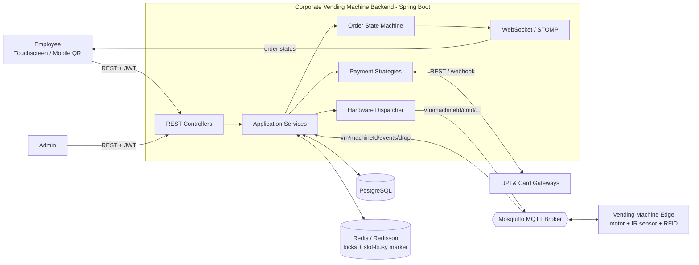
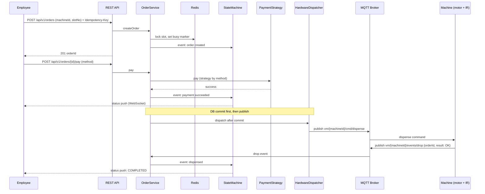
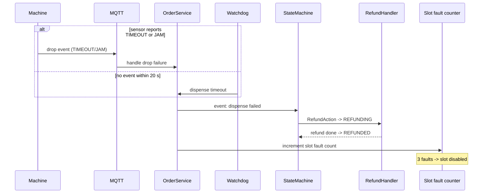
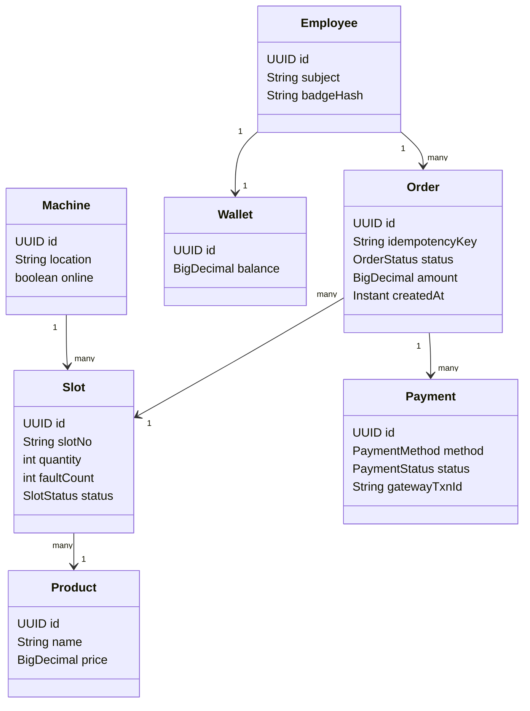
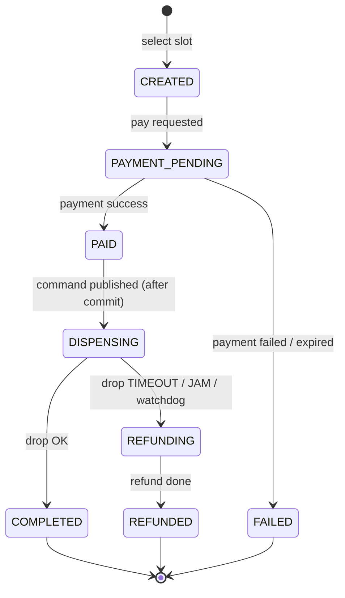
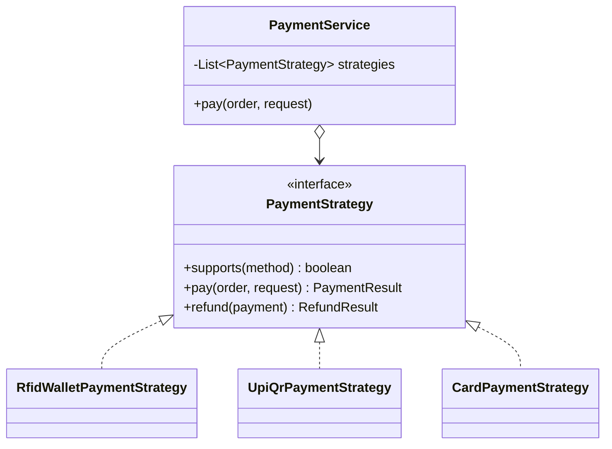

# Corporate Vending Machine Backend

Spring Boot 3.3 / Java 21 backend for an office vending machine. Employees order from a touchscreen or a mobile QR code, pay with an **RFID badge wallet**, **UPI dynamic QR** or **card**, and the machine dispenses via a motor whose drop is confirmed by an **IR sensor**. Failed drops are refunded automatically, and repeatedly faulty slots are isolated.

**Stack:** Spring Data JPA + PostgreSQL (Flyway) · Spring Security (JWT resource server) · Spring StateMachine · Spring Integration MQTT (Paho) · Redis + Redisson · MapStruct · Lombok · springdoc OpenAPI

> **Status:** the source has not yet been compiled against the real dependencies. Expect small compile or wiring fixes on the first `mvn verify`.

---

## Table of contents

1. [Features](#1-features)
2. [High-Level Design (HLD)](#2-high-level-design-hld)
3. [Low-Level Design (LLD)](#3-low-level-design-lld)
4. [Design patterns used](#4-design-patterns-used)
5. [End-to-end usage guide](#5-end-to-end-usage-guide)
6. [Configuration](#6-configuration)
7. [Testing](#7-testing)
8. [Docker](#8-docker)
9. [Known gaps and roadmap](#9-known-gaps-and-roadmap)

---

## 1. Features

- Order a product by machine and slot, with idempotent order creation (`Idempotency-Key` header)
- Multiple payment methods: RFID badge wallet, UPI dynamic QR, card
- Order lifecycle managed by an explicit state machine
- Hardware control over MQTT (dispense command out, IR-sensor event in)
- Dispense watchdog: no sensor reply within 20 s counts as a failed drop and triggers a refund
- Per-slot fault accounting: 3 faults disables the slot
- Distributed locking and a slot "busy" marker to prevent double-selling a slot
- Real-time status push to the UI over WebSocket (STOMP)
- JWT-secured REST API with role-based access (`EMPLOYEE`, `ADMIN`)
- OpenAPI/Swagger documentation

---

## 2. High-Level Design (HLD)

### 2.1 Actors

| Actor | Role |
|---|---|
| Employee | Selects a slot and pays via badge, UPI or card |
| Admin | Manages machines, slots, stock and employee wallets |
| Vending machine (edge) | Touchscreen, RFID reader, motors, IR drop sensor; talks MQTT |
| Payment gateways | UPI and card providers (REST and webhooks) |

### 2.2 System context



### 2.3 Architecture style

The code follows **Hexagonal (Ports and Adapters)** architecture:

- **Domain** holds entities, enums, events and exceptions, with no framework logic.
- **Application** holds use-case services, payment strategies, hardware commands, the state machine and outbound ports.
- **Adapters (inbound)** are REST controllers, MQTT listeners and WebSocket push.
- **Adapters (outbound)** are JPA repositories, the MQTT publisher and payment gateway clients.

### 2.4 Main components

| Component | Responsibility |
|---|---|
| REST API | Create orders, pay, query status, admin operations. Security is a JWT resource server. |
| Order service | Orchestrates the order use case and enforces idempotency. |
| Order state machine | Single source of truth for order status transitions (guards and actions). |
| Payment module | Strategy per payment method: RFID wallet debit, UPI QR, card charge, refunds. |
| Hardware dispatcher | Publishes dispense commands to MQTT **after the DB commit**. |
| MQTT inbound adapter | Receives drop events (`OK`, `TIMEOUT`, `JAM`) from machines. |
| Watchdog | Detects missing sensor confirmations and triggers refund. |
| Refund handler | Reverses the payment and moves the order to `REFUNDED`. |
| Slot fault accounting | Counts faults per slot and disables a slot after 3. |
| PostgreSQL | Machines, slots, orders, payments, wallets, employees. Schema is versioned by Flyway. |
| Redis / Redisson | Distributed locks and the slot "busy" marker (5 min TTL). |
| MQTT broker (Mosquitto) | Message bus between backend and machines. |

### 2.5 End-to-end sequence (happy path)



### 2.6 Failure path (refund)



### 2.7 Non-functional design decisions

| Concern | Decision |
|---|---|
| Idempotency | `Idempotency-Key` on order creation prevents duplicate orders on retries |
| Consistency | The MQTT command is sent only **after DB commit**, so the machine can never reply before the order shows `DISPENSING` |
| Concurrency | Redis/Redisson lock plus a slot busy marker (TTL 5 min) prevents two users buying the same slot |
| Resilience | Dispense watchdog and automatic refund; per-slot fault isolation |
| Security | JWT (HS256 shared secret by default), role-based endpoints, RFID badge stored and sent as a SHA-256 hash, HMAC-SHA256 `X-Signature` on payment webhooks |
| Observability | Swagger UI, structured `ProblemDetail` error responses |
| Portability | Docker and docker-compose for PostgreSQL, Redis, Mosquitto |

---

## 3. Low-Level Design (LLD)

### 3.1 Package layout

```
src/main/java/.../
├── domain/
│   ├── enums/             order status, payment method, ...
│   ├── model/             JPA entities (Machine, Slot, Order, Payment, Employee, Wallet, ...)
│   ├── event/             domain events
│   └── exception/         business exceptions
├── application/
│   ├── dto/               request / response objects
│   ├── payment/           PaymentStrategy + RFID / UPI / Card implementations
│   ├── hardware/          dispense commands
│   ├── service/           OrderService, HardwareDispatcherService, RefundHandler, ...
│   ├── statemachine/      states, events, guards, actions, OrderStateMachineService
│   └── port/out/          outbound interfaces (persistence, messaging, gateways)
├── adapter/
│   ├── in/
│   │   ├── rest/          controllers, ProblemDetail advice
│   │   ├── mqtt/          inbound drop-event listener + observer
│   │   └── ws/            STOMP push
│   └── out/
│       ├── persistence/   Spring Data repositories, wallet adapter
│       ├── mqtt/          command publisher
│       └── gateway/       UPI / card REST clients
└── config/                security, OpenAPI
```

### 3.2 Core domain model



> Entity and field names are indicative. Align them with your actual JPA classes.

### 3.3 Order state machine



> `REFUNDED` is a terminal state (`REFUNDING -> REFUNDED`) and matches the DB check constraint. Verify the other state names against your `OrderStatus` enum.

`OrderStateMachineService.fire(...)` returns the resulting state. A rejected event or failed guard returns the **unchanged** state. Guards validate preconditions (for example, slot enabled, payment amount matches). Actions perform side effects (for example, `RefundAction` calls `RefundHandler`).

### 3.4 Payment module



| Method | Flow |
|---|---|
| `RFID` | Hash of the badge ID is matched to an employee, then the wallet is debited atomically. Synchronous. |
| `UPI` | Gateway creates a dynamic QR (`/v1/qr`). Payment confirmation arrives through a signed webhook. Asynchronous. |
| `CARD` | Gateway charge (`/v1/charges`). Refund via `/v1/refunds`. |

### 3.5 Hardware and messaging

| Direction | Topic | Payload |
|---|---|---|
| Backend to machine | `vm/{machineId}/cmd/dispense` | dispense command (order ID, slot) |
| Machine to backend | `vm/{machineId}/events/drop` | `{"orderId":"...","result":"OK \| TIMEOUT \| JAM"}` |

`HardwareDispatcherService` publishes the command only after the DB transaction commits. The inbound adapter parses drop events and notifies the order service (via the observer/event mechanism).

### 3.6 REST API summary

| Method | Endpoint | Description | Roles |
|---|---|---|---|
| `POST` | `/api/v1/orders` | Select a slot and create an order. Header: `Idempotency-Key`. Body: `{machineId, slotNo}` | EMPLOYEE |
| `POST` | `/api/v1/orders/{id}/pay` | Pay for the order. Body: `{method, badgeHash?}` | EMPLOYEE |
| `GET`  | `/api/v1/orders/{id}` | Get order status | EMPLOYEE |
| `POST` | `/dev/token` | Issue a test JWT (**dev profile only**) | none |
| `POST` | payment webhook | Gateway callback `{orderId, txnId, status}` with `X-Signature` | gateway |

Full, authoritative list: Swagger UI at `http://localhost:8080/swagger-ui.html`.

### 3.7 Error handling

Controllers share one advice that maps domain exceptions to RFC 7807 `ProblemDetail` responses (for example slot unavailable, insufficient wallet balance, invalid state transition).

---

## 4. Design patterns used

| # | Pattern | Where it appears | Why |
|---|---|---|---|
| 1 | **Strategy** | `PaymentStrategy` with RFID / UPI / Card implementations | Add or swap a payment method without touching order logic (Open/Closed) |
| 2 | **State** (via Spring StateMachine) | `application/statemachine` | Explicit, validated order lifecycle with guards and actions |
| 3 | **Observer / Publish-Subscribe** | Domain events, MQTT inbound observer, WebSocket push | Decouples "something happened" from who reacts |
| 4 | **Command** | `application/hardware` dispense commands published to the machine | Encapsulates a request as an object sent over MQTT |
| 5 | **Adapter / Ports and Adapters (Hexagonal)** | `port.out` interfaces with `adapter/out` implementations (JPA, MQTT, UPI/card clients) | Domain is independent of infrastructure and testable |
| 6 | **Repository** | Spring Data JPA repositories | Abstracts persistence |
| 7 | **Facade** | `OrderService` | Single simple entry point over payment, state machine, locking and hardware |
| 8 | **Factory / Registry (strategy selection)** | `PaymentService` picks the strategy from the injected list by method | Runtime selection of the right strategy |
| 9 | **DTO / Mapper** | `application/dto` with MapStruct | Keeps entities out of the API layer |
| 10 | **Builder** | Lombok `@Builder` on entities and DTOs | Readable object construction |
| 11 | **Dependency Injection / IoC** | Spring beans throughout | Loose coupling, easy mocking |
| 12 | **Singleton** | Spring-managed beans (default scope) | Shared stateless services |

Related architectural patterns (not GoF): **Idempotency key**, **Distributed lock** (Redisson), **Compensating action / Saga-style refund**, **After-commit dispatch** (outbox-like ordering guarantee) and **Watchdog/timeout**.

---

## 5. End-to-end usage guide

### 5.1 Prerequisites

- JDK 21
- Maven 3.9+
- Docker and Docker Compose
- `curl`, `python3`, and optionally the Mosquitto clients (`mosquitto_sub`, `mosquitto_pub`)

### 5.2 Start infrastructure and the app

```bash
git clone https://github.com/coder-stat920715/corporate-vending-machine.git
cd corporate-vending-machine

docker compose up -d        # PostgreSQL, Redis, Mosquitto
mvn spring-boot:run         # dev profile: Flyway also loads db/seed
```

The dev seed contains **1 machine, 3 slots and 1 employee**. Open Swagger UI at <http://localhost:8080/swagger-ui.html>.

### 5.3 Get a token (dev only)

```bash
TOKEN=$(curl -s -X POST "localhost:8080/dev/token?subject=asha&roles=EMPLOYEE,ADMIN" \
  | python3 -c "import sys,json;print(json.load(sys.stdin)['access_token'])")
M=11111111-1111-1111-1111-111111111111      # seeded machine ID
```

### 5.4 Step 1: select a slot and create the order

```bash
curl -s -X POST localhost:8080/api/v1/orders \
  -H "Authorization: Bearer $TOKEN" \
  -H "Idempotency-Key: demo-1" \
  -H "Content-Type: application/json" \
  -d "{\"machineId\":\"$M\",\"slotNo\":\"A1\"}"
```

Note the returned `orderId`. Repeating the call with the same `Idempotency-Key` returns the same order instead of creating a duplicate.

### 5.5 Step 2: pay

**RFID badge wallet** (seeded badge `BADGE-1001`, hash is its SHA-256):

```bash
curl -s -X POST localhost:8080/api/v1/orders/<ORDER_ID>/pay \
  -H "Authorization: Bearer $TOKEN" -H "Content-Type: application/json" \
  -d '{"method":"RFID","badgeHash":"3dbb5151b832d233abf1c58a66f89c6beec3a529d0bf52b1f48d2b87b19cf9c2"}'
```

**UPI:** call `pay` with `{"method":"UPI"}`, display the returned QR, and the gateway confirms through the signed webhook.
**Card:** call `pay` with `{"method":"CARD", ...}` per your gateway integration.

### 5.6 Step 3: watch the dispense command and simulate the machine

```bash
# terminal 1: watch commands sent to machines
mosquitto_sub -h localhost -t 'vm/+/cmd/#' -v

# terminal 2: simulate the IR sensor confirming the drop
mosquitto_pub -h localhost -t "vm/$M/events/drop" \
  -m '{"orderId":"<ORDER_ID>","result":"OK"}'
```

The order moves to `COMPLETED`.

### 5.7 Failure scenarios to try

| Simulate | Result |
|---|---|
| Publish `{"orderId":"<ID>","result":"TIMEOUT"}` or `"JAM"` | Order is refunded (`REFUNDING` then `REFUNDED`) and the slot fault count increases |
| Send no drop event for 20 s (`vending.order.dispense-timeout-seconds`) | Watchdog treats it as a failed drop and refunds |
| Trigger 3 faults on one slot | Slot is disabled |
| Reuse the same `Idempotency-Key` | Same order returned, no duplicate |
| Select a slot that already has an active order | Rejected (slot busy) |

### 5.8 Typical real-world flow

1. Employee walks up, selects an item on the touchscreen (or scans the mobile QR).
2. App calls **create order**; the slot is locked.
3. Employee taps the badge (RFID), scans the UPI QR, or uses a card; the app calls **pay**.
4. Backend confirms payment, commits, then publishes the **dispense command**.
5. Machine runs the motor; the IR sensor confirms the drop and the machine publishes `OK`.
6. Order completes and the UI is updated over WebSocket. If anything fails, the employee is **refunded automatically**.

---

## 6. Configuration

| Property / env var | Purpose |
|---|---|
| `DB_URL`, `DB_USERNAME`, `DB_PASSWORD` | PostgreSQL connection |
| `REDIS_HOST` | Redis / Redisson |
| `MQTT_BROKER_URL` | MQTT broker (use `ssl://` in production) |
| `JWT_SECRET` | HS256 secret, **32+ characters** |
| `UPI_WEBHOOK_SECRET` | HMAC secret for webhook signature verification |
| `vending.order.dispense-timeout-seconds` | Dispense watchdog timeout (default 20) |

---

## 7. Testing

```bash
mvn test
```

- `PaymentStrategyTest` for payment strategies
- `OrderServiceTest` (Mockito) for order orchestration
- `StateMachineFlowTest` (`@SpringBootTest`, real state machine with mocked guards and actions)

No database or broker is needed for the tests.

---

## 8. Docker

```bash
docker build -t corporate-vending-machine .
docker run -p 8080:8080 \
  -e DB_URL=jdbc:postgresql://host/vending \
  -e DB_USERNAME=... -e DB_PASSWORD=... \
  -e JWT_SECRET=<32+ chars> \
  -e UPI_WEBHOOK_SECRET=... \
  -e REDIS_HOST=... \
  -e MQTT_BROKER_URL=ssl://... \
  corporate-vending-machine
```

---

## 9. Known gaps and roadmap

- Offline RFID replay: the `offline_transactions` table exists, but ingestion code is not included yet.
- Dispense commands are not HMAC-signed; use broker TLS and per-machine ACLs.
- Gateway adapters assume a generic REST shape (`/v1/qr`, `/v1/charges`, `/v1/refunds`, webhook `{orderId, txnId, status}` with `X-Signature`). Adapt them to your PSP.
- JWT uses a shared HS256 secret. For a corporate IdP, replace the `JwtDecoder` bean with an issuer-based one.
- One item per order (no cart).
- Source not yet compiled against real dependencies (see status note at the top).
